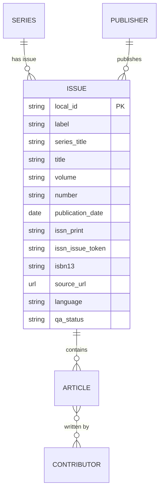

# Mute Entity-Relationship Model (Phase 1: Issues)

Status: DRAFT v0.1, 2026-11-18. Bottom-up from `output/issues_normalized.csv` (51 issues).
Alignment to external schemas is in [schema-alignment.md](schema-alignment.md).
Machine-readable form: [xml/mute-issues.dtd](xml/mute-issues.dtd), mapping in [etl/field_mapping.yml](etl/field_mapping.yml).

## Scope

Phase 1 models **Issue** only. Series, publisher, article and contributor are
literal attributes or deferred entities (see "Deferred entities").

Out of scope rows (reported in `issues_qa_report.csv`): Special insert, Box 1, Box 2.

## Verified Wikidata anchors (checked 2026-11-18)

| Thing | Wikidata | Note |
|---|---|---|
| Mute Magazine (series) | `Q6943763` | the periodical |
| Mute Publishing | `Q115486583` | publisher (deferred as entity) |
| issue (class) | `Q28869365` | "issue of a newspaper, a scientific journal or magazine" |
| magazine (class) | `Q41298` | generic class, NOT the Mute series |
| periodical (class) | `Q1002697` | generic class |
| Only existing Mute issue on Wikidata | `Q115859890` | Vol 1 No 0 (pilot) |

The earlier stub used `Q41298` as "Part of Mute Magazine". That was wrong:
`Q41298` is the class "magazine". The series is `Q6943763`.

## Entity: Issue

One published issue of Mute (an inventory-numbered item in the catalogue).

| Attribute | Type | Card. | Source column | Wikidata | Notes |
|---|---|---|---|---|---|
| `local_id` | string `MIxxx` | 1 | `source_inventory_number` | none | Stable local key (zero padded, e.g. `MI001`). Primary key. |
| `label` | string | 1 | derived | label | `Mute Vol {v}, No. {n} - {title}` (title omitted if empty). |
| `series_title` | string | 1 | `series_title` | `P1433` (to Q6943763) | Literal `Mute` in phase 1. |
| `title` | monolingual text (en) | 0..1 | `issue_title` | `P1476` | Empty for Vol 1 No 5, 6, 7 and 9: no thematic title. Not an error. |
| `volume` | string | 1 | `volume` | `P478` | |
| `number` | string | 1 | `number` | `P433` | Pilot is `0`. Wikidata item `Q115859890` uses `"01"` (the ISSN suffix), a discrepancy to resolve. |
| `publication_date` | date, month precision | 1 | `publication_date_iso` | `P577` | `YYYY-MM`, precision 10 (month). Wikidata pilot uses day precision (1994-11-30). |
| `issn_print` | external id | 1 | `issn_print` | `P236` | Series ISSN `1356-7748` (same for all). |
| `issn_issue_token` | string | 1 | `issn_issue_token` | none | Per-issue token, e.g. `1356-7748-01`. Unique. Local convention, not a real ISSN. |
| `isbn13` | external id | 0..1 | `isbn` | `P212` | Only if checksum-valid. |
| `isbn_raw` | string | 0..1 | `isbn` | none | Original value kept for review when invalid. |
| `source_url` | url | 1 | `source_url_html` | `P953` | metamute.org issue page. |
| `language` | string (code) | 1 | `language` | `P407` | `en`. |
| `edition_note` | string | 0..1 | parsed from `issue_label_raw` | none | e.g. `second edition`. |
| `insert_note` | string | 0..1 | parsed from `issue_label_raw` | none | Inserts / CDs / booklets. |
| `sort_key` | string | 1 | `sort_key_final` | none | Chronological + printed order. |
| `qa_status` | string | 1 | derived from `qa_*` | none | `draft` while any `qa_needs_*` flag is `yes`. |
| `label_raw` | string | 1 | `issue_label_raw` | none | Provenance. |
| `wikidata_qid` | external id | 0..1 | Wikidata match | none | Filled after the Wikidata match. |

Keys and uniqueness:

- `local_id` unique (inventory number).
- `issn_issue_token` unique.
- (`volume`, `number`) unique.
- ISBN is NOT unique (two repeated values, see data findings).

## Relationships

Phase 1 implements the `ISSUE` entity only. `SERIES`, `PUBLISHER`, `ARTICLE` and
`CONTRIBUTOR` are not created as entities yet.

## Deferred entities

| Entity | Phase | Why deferred |
|---|---|---|
| Series (Mute Magazine) | 2 | Held as literal `series_title`; Wikidata `Q6943763` already exists. |
| Publisher (Mute Publishing) | 2 | `Q115486583` exists; add `P123` later. |
| Article | 2 | Pilot data in `output/articles_catalog_pilot1.csv`. |
| Contributor | 2 | Pilot data in `output/contributors_catalog_pilot1.csv`. |

## Data findings (profile of `issues_normalized.csv`, 51 rows)

1. All `qa_needs_*` flags are `yes`: the data is a **draft** and is loaded with `qa_status=draft`.
2. `issue_title` is empty for Vol 1 No 5, 6, 7, 9. Titles of No 25-28 are season labels, e.g. `(Winter/Spring 2003)`.
3. ISBN problems:
   - 12-digit (truncated, invalid): Vol 2 No 3 `978190649633`, No 4 `978190649614`, No 5 `978190649614`, No 7 `978190649694`, No 11 `978190649625`.
   - Repeated: `978190649614` (Vol 2 No 4 and 5), `9781906496340` (Vol 2 No 12 and 13).
   - Valid ISBN-13s are loaded as `isbn13`; the rest stay in `isbn_raw` only.
4. Notes embedded in `issue_label_raw` (inserts, "second edition") are parsed into `edition_note` and `insert_note`.
5. Per-issue tokens such as `1356-7748-X8` and `1356-7748-200` are a local numbering scheme, not registered ISSNs.
6. Wikidata `Q115859890` has `P433="01"` where this model has number `0`; resolve at Wikidata match time.

## Open questions

1. Should the per-issue token be modelled as an identifier property of its own (as here) or as a `P1545` series ordinal?
2. Month-precision dates (here) vs. day precision (Wikidata pilot item).
3. Should the 3 excluded rows (Special insert, Box 1, Box 2) become a separate entity type (`Supplement`/`Archive box`) in phase 2?
